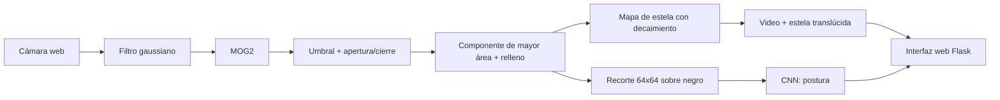

# ESPECTRAZO

**Tu movimiento, en estela.** Sistema de procesamiento digital de imágenes en tiempo real que segmenta la silueta de una persona frente a una cámara web, acumula sus posiciones recientes como una estela de color translúcida y clasifica su postura con una red neuronal convolucional (CNN). Se usa desde una interfaz web local.

---

## Contenido

1. [Descripción del proyecto](#1-descripción-del-proyecto)
2. [Arquitectura del sistema](#2-arquitectura-del-sistema)
3. [Metodología](#3-metodología)
4. [Implementación](#4-implementación)
5. [Instrucciones de ejecución](#5-instrucciones-de-ejecución)
6. [Datos](#6-datos)
7. [Guía de uso de la interfaz gráfica (GUI)](#7-guía-de-uso-de-la-interfaz-gráfica-gui)
8. [Resultados](#8-resultados)
9. [Conclusiones](#9-conclusiones)
10. [Autores](#autores)

---

## 1. Descripción del proyecto

**ESPECTRAZO** busca representar en tiempo real el recorrido del movimiento corporal mediante una estela. El proyecto surge de la necesidad de visualizar el movimiento de una persona mientras ocurre, sin depender de técnicas como la fotografía de larga exposición o la cronofotografía, que requieren equipos especializados y edición posterior.

El sistema usa una cámara web para capturar el movimiento, separa la silueta de la persona del fondo y acumula sus posiciones anteriores con transparencia decreciente, lo que genera un efecto visual de espectro. Además, una CNN reconoce la postura de la persona (agachado, brazos abiertos, brazos arriba o de pie).

### Objetivo general

Desarrollar un sistema de procesamiento digital de imágenes en tiempo real que permita segmentar la silueta de una persona en movimiento y acumular sus posiciones recientes para generar un efecto de estela visual.

### Objetivos específicos

- Implementar la captura de video y la segmentación de personas mediante sustracción de fondo adaptativa.
- Generar siluetas limpias mediante umbralización y operaciones morfológicas.
- Desarrollar un sistema de acumulación de siluetas con transparencia decreciente.
- Clasificar la postura de la persona con una CNN entrenada sobre las siluetas.
- Evaluar la calidad visual y el rendimiento del sistema en tiempo real.

---

## 2. Arquitectura del sistema

El sistema se compone de siete etapas:

1. **Captura de video:** fotogramas de la cámara web con OpenCV (640 × 480, espejado horizontal).
2. **Preprocesamiento:** filtro gaussiano (5 × 5) para reducir ruido y variaciones de iluminación.
3. **Detección de movimiento:** sustracción de fondo adaptativa MOG2. Durante los primeros 30 cuadros aprende el fondo.
4. **Segmentación de silueta:** umbralización, apertura y cierre morfológico, selección del componente conectado de mayor área y relleno de huecos.
5. **Acumulación de posiciones:** un mapa de opacidad que decae en cada cuadro y se reinicia donde está la persona.
6. **Visualización:** el video normal con la estela de color mezclada con transparencia, más los FPS y la postura detectada.
7. **Clasificación de postura:** la CNN analiza el recorte de la silueta cada 3 cuadros y se vota sobre las últimas 5 predicciones para estabilizar el resultado.



---

## 3. Metodología

El desarrollo se organizó en seis fases:

- **Fase 1. Planeación:** alcance, revisión de conceptos y preparación del entorno.
- **Fase 2. Adquisición y preprocesamiento:** captura de video y reducción de ruido.
- **Fase 3. Detección de movimiento:** sustracción de fondo adaptativa (MOG2).
- **Fase 4. Obtención de silueta:** umbralización, apertura y cierre morfológico.
- **Fase 5. Acumulación y efecto espectro:** estela con transparencia decreciente.
- **Fase 6. Integración y pruebas:** unión de los módulos, clasificador de postura, interfaz web, evaluación y documentación.

### Técnicas y modelos utilizados

- Sustracción de fondo adaptativa (MOG2).
- Filtro gaussiano.
- Umbralización.
- Apertura y cierre morfológico.
- Selección del componente conectado de mayor área y relleno de contornos.
- Composición de imágenes con transparencia (mezcla alfa).
- Red neuronal convolucional (CNN) para clasificación de posturas.

---

## 4. Implementación

### Tecnologías

- **Python 3:** lenguaje principal.
- **OpenCV:** captura y procesamiento de imágenes.
- **NumPy:** manipulación de imágenes como matrices.
- **PyTorch:** definición e inferencia de la CNN.
- **Flask:** servidor web local.
- **HTML, CSS y JavaScript:** interfaz gráfica.
- **Visual Studio Code, Google Colab:** desarrollo y entrenamiento.
- **Git y GitHub:** control de versiones.

### Estructura del repositorio

```
espectrazo/
├── app.py                 # Servidor Flask, bucle de cámara y endpoints
├── pipeline.py            # Segmentación, estela y CNN
├── templates/
│   └── index.html         # Interfaz web
├── models/
│   └── cnn_posturas.pt    # Pesos de la CNN entrenada
├── recordings/            # Videos guardados desde la interfaz
├── notebooks/             # Notebook de entrenamiento (Colab)
├── requirements.txt
└── README.md
```

### Módulos principales (`pipeline.py`)

| Elemento | Función |
|---|---|
| `Segmentador` | Filtro gaussiano, MOG2, umbral, morfología, componente de mayor área y relleno de huecos. |
| `Espectro` | Mantiene el mapa de estela con decaimiento y lo mezcla sobre el video. |
| `crop_para_cnn` | Recorta la silueta (color real sobre negro), la pasa a cuadrado y la reduce a 64 × 64. |
| `CNN` | 3 bloques conv (16, 32, 64 filtros) con BatchNorm, ReLU y MaxPool, seguidos de Dropout, capa lineal de 128 y salida de 4 clases. |
| `Clasificador` | Carga `cnn_posturas.pt`, deduce el tamaño de entrada y el número de clases desde los pesos y predice la postura. |

### Parámetros principales

- Aprendizaje del fondo: 30 cuadros. MOG2 con `history=300` y `varThreshold=25`.
- La estela decae hasta el 5 % de su opacidad después de N cuadros (N = "Longitud de la estela").
- Clasificación cada 3 cuadros, con voto de las últimas 5 predicciones.
- Normalización de entrada a la CNN: `(x − 0.5) / 0.5` en RGB.

---

## 5. Instrucciones de ejecución

### Requisitos

- Windows, macOS o Linux con **cámara web**.
- **Python 3.10 a 3.12.**
- Git (opcional; también se puede descargar el ZIP desde GitHub).

### Instalación y ejecución

```bash
# 1. Descargar el proyecto
git clone https://github.com/angelesAnchico07/espectrazo.git
cd espectrazo

# 2. Crear y activar el entorno virtual
python -m venv venv
venv\Scripts\activate            # Windows (Mac/Linux: source venv/bin/activate)

# 3. Instalar dependencias
pip install -r requirements.txt

# 4. Ejecutar
python app.py
```

Abre **http://127.0.0.1:5000** en el navegador. Este enlace solo funciona mientras `python app.py` esté corriendo en tu mismo computador.

> El modelo `models/cnn_posturas.pt` debe estar en la carpeta `models/`. Si no está, la app funciona, pero muestra "sin modelo" en lugar de la postura.

### Problemas frecuentes

| Problema | Solución |
|---|---|
| `python` no se reconoce | Activar el entorno virtual con `venv\Scripts\activate` o reinstalar Python marcando "Add Python to PATH". |
| `activate` bloqueado en PowerShell | Ejecutar `Set-ExecutionPolicy -Scope Process Bypass` y volver a activar. |
| "No se pudo acceder a la cámara" | Cerrar otras apps que usen la cámara (Meet, Zoom) y permitir el acceso en la configuración del sistema. |
| `ERR_CONNECTION_REFUSED` | La app no está corriendo: ejecutar `python app.py` y dejar la terminal abierta. |
| Aparecen zonas raras o manchas en la silueta | Pulsar **Recalibrar fondo**, salir del cuadro 2 o 3 segundos y volver a entrar. |

---

## 6. Datos

### Entrada del sistema

La entrada principal es el video de la cámara web, procesado cuadro a cuadro en tiempo real. La estela no depende de ningún conjunto de datos externo.

### Datos de entrenamiento de la CNN

La CNN se entrenó con recortes de siluetas obtenidos con el mismo pipeline de segmentación del sistema: persona con su color real sobre fondo negro, recortada en cuadrado y escalada a 64 × 64.

- **Clases (4):** `agachado`, `brazos_abiertos`, `brazos_arriba`, `de_pie`.
- **Cantidad de imágenes y división entrenamiento/validación/prueba:** [COMPLETAR].
- **Enlace al conjunto de datos o carpeta de Drive:** [COMPLETAR].
- **Notebook de entrenamiento (Colab):** [COMPLETAR: enlace o ruta en `notebooks/`].

### Escenarios de prueba

- Personas con distintos movimientos.
- Fondos lisos y fondos con objetos.
- Iluminación alta, baja y cambiante.
- Movimientos lentos y rápidos.

Ejemplos de fotogramas y máscaras obtenidas: [COMPLETAR: imágenes en `docs/img/`].

---

## 7. Guía de uso de la interfaz gráfica (GUI)

### Pantalla 1: inicio

1. Ubícate frente a la cámara con el fondo visible y sin personas detrás.
2. Pulsa **Iniciar cámara**.

### Pantalla 2: resultados

1. **Aprendiendo el fondo:** durante los primeros segundos, sal del cuadro. La app lo indica en un mensaje bajo la imagen.
2. Entra al cuadro y muévete. Verás tu imagen normal y, detrás de ti, una estela de color que se desvanece.
3. Usa los controles de la derecha:

| Control | Qué hace |
|---|---|
| **Longitud de la estela** (2–60) | Cuántos cuadros tarda la estela en desvanecerse. |
| **Intensidad** (10–100 %) | Qué tan opaca se ve la estela. |
| **Color** | Color de la estela. |
| **Fondo** | *Video*: la estela sobre la imagen de la cámara. *Negro*: solo la estela sobre fondo negro. |
| **Recalibrar fondo** | Vuelve a aprender el fondo. Úsalo si cambió la iluminación o la escena, saliendo antes del cuadro. |
| **Guardar video** | Empieza a grabar. Pulsa **Detener y guardar** para terminar. El archivo `.mp4` aparece con un enlace de descarga y queda en `recordings/`. |
| **Volver a inicio** | Detiene la cámara y regresa a la primera pantalla. |

4. Indicadores bajo la imagen: **FPS** (rendimiento) y **Postura** (clase detectada con su porcentaje de confianza).

### Consejos

- Cámara fija y fondo estable.
- Evita ropa del mismo color que la pared.
- Buena iluminación, sin cambios bruscos.

---

## 8. Resultados

La evaluación contempla calidad visual y rendimiento. Metas iniciales: IoU ≥ 0,85, valoración promedio ≥ 4 de 5 y al menos 20 FPS a 640 × 480.

| Métrica | Meta | Resultado |
|---|---|---|
| Exactitud de la CNN (conjunto de prueba) | — | 86,2 % (`model_base`) |
| IoU de la segmentación | ≥ 0,85 | ≈ 0,80 – 0,88 *(estimado, sin medir)* |
| Dice | — | ≈ 0,88 – 0,93 *(estimado, sin medir)* |
| Componentes espurios / % de huecos | — | Cercanos a 0 con apertura, cierre y relleno de contornos *(observación cualitativa)* |
| Estabilidad temporal | — | Alta con la persona quieta, con leves variaciones en el borde *(observación cualitativa)* |
| Valoración visual de la estela (Likert 1–5) | ≥ 4 | Pendiente de encuesta |
| FPS a 640 × 480 | ≥ 20 | ≈ 8 (observado en la interfaz; por debajo de la meta) |
| Latencia | — | ≈ 125 ms por cuadro (1000 / 8 FPS) |

**Capturas de funcionamiento:** [COMPLETAR: agregar imágenes de la estela, de la interfaz y de la matriz de confusión de la CNN en `docs/img/` y enlazarlas aquí].

---

## 9. Conclusiones

[COMPLETAR con los resultados reales. Puntos sugeridos:]

- Grado de cumplimiento de los objetivos y de las metas de IoU, calidad visual y FPS.
- Calidad de la segmentación con MOG2 y las operaciones morfológicas.
- Comportamiento de la estela y efecto de los parámetros (longitud, intensidad).
- Desempeño de la CNN por clase y confusiones frecuentes entre posturas.
- **Limitaciones observadas:** la segmentación depende de un fondo estable y de que la ropa se distinga del fondo; la cámara debe estar fija; el procesamiento corre en un servidor local con la cámara del mismo computador.
- **Mejoras futuras:** capturar la cámara desde el navegador para permitir una versión en línea, usar un modelo de segmentación de personas más robusto y ampliar el conjunto de posturas.

---

## Autores

- Angeles Anchico Quiñones
- Valeria Garcia Perez

**Universidad Autónoma de Occidente**
Asignatura: Procesamiento Digital de Imágenes
Docente: Nicolás Llanos Neuta
2026
